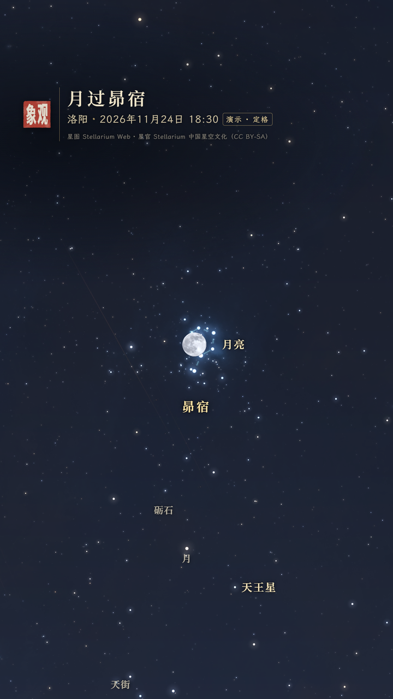
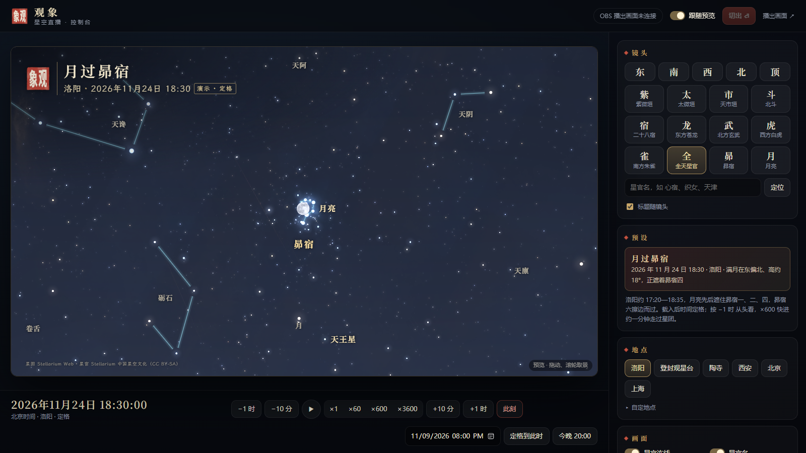

# 观象 · 中文星空直播（v2）

给观象视频号、YouTube 直播用的中文星图：控制台在本机操作，OBS 抓取独立的播出画面。星空由 Stellarium Web 官方引擎实时计算和渲染，星官名称与连线来自 Stellarium 中国星空文化；中文名、地景和字幕由本工具画在引擎画面之上。

## 开始

1. Windows 双击 `Start-ChineseSky.cmd`（需要 Python 3.10 以上、能访问 Stellarium 官方资源的网络）。其他系统在本目录运行 `python server.py`。
2. 浏览器自动打开控制台 http://127.0.0.1:8765/ 。
3. OBS 添加“浏览器”来源，URL 填 http://127.0.0.1:8765/program ；横屏 1920×1080，竖屏 1080×1920，30 fps；关闭“不可见时关闭源”和“场景激活时刷新浏览器”。OBS 连上后，控制台顶栏显示画幅与帧率，预览画幅自动跟着变。
4. 开播前先在控制台把要讲的镜头点一遍：星图资源会缓存到本目录 `.cache/`，之后重启或网络不稳时，看过的天区直接从本机读取。

## 控制台

- **镜头**：东南西北与头顶；紫微、太微、天市三垣，北斗，二十八宿与四象七宿，全天星官；昴宿、月亮；也可输入任意星官名定位。目标此刻在地平线下时，自动换成“全天球”地景，回到方位镜头时再换回来。
- **跟随预览**（默认开）：在预览里拖动、滚轮缩放，播出画面同步平滑跟随。关掉后，点镜头只动预览，准备好再按“切出”（Enter）送到播出画面。
- **时间**：此刻（实时）；定格到某一时刻；±10 分、±1 时；×1、×60、×600、×3600 快进，空格定格／继续。一天以内的跳转会平滑扫过去，不是硬切。所有时间按北京时间显示。
- **预设“月过昴宿”**：2026-11-24 18:30 洛阳。按洛阳站心计算（Skyfield，DE421），满月约 17:20—18:35 先后遮住昴宿一（17:20—18:06）、昴宿二（17:47—18:14）、昴宿四（17:46—18:34）和较暗的昴宿增九，昴宿六擦边而过；18:30 月高约 18°、方位约 72°。按 −1 时 从月出不久看起，×600 快进约一分钟走过星团。
- **画面**：星官连线、星官名、亮星名、五星古名（太白、岁星、荧惑、填星、辰星）、大气、赤道网格、标题字幕；地景“山水”（水墨远山，西南方有登封观星台剪影）、“原野”（官网默认地景）、“全天球”（不画地面，暗底星图，地平线用虚线标出）；标题与一行字幕可随时改，“标题随镜头”可关。
- **快捷键**：`1` 紫微垣 `2` 太微垣 `3` 天市垣 `4` 二十八宿 `5` 北斗 `0` 全天 `P` 昴宿 `M` 月亮 `T` 此刻 `空格` 定格／继续 `F` 跟随 `Enter` 切出。

竖屏预览会用虚线标出视频号直播间顶栏和评论区；星名不会排进顶栏。

## 与实景、YouTube 配合

OBS 分“中文星图、实景、主播讲述”几个 Scene，推到 YouTube 由 OBS 统一输出。转播他人的望远镜或全天相机画面，先取得许可、注明来源，星图的地点和时间按对方画面的拍摄地点与时间戳设置；直播画面有延迟。逐像素叠到相机画面上需要另外标定视场、朝向和镜像。

- [OBS Browser Source](https://obsproject.com/kb/browser-source)
- [使用编码器创建 YouTube 直播](https://support.google.com/youtube/answer/2907883?hl=zh-Hans)

## 结构与维护

| 文件 | 作用 |
|---|---|
| `server.py` | 本机服务：直播状态（EventSource 推送）、按分组生成星空文化、代理并缓存官方资源、OBS 心跳 |
| `web/sky.js` | 播出页与预览页：驱动引擎（文化、地点、时间、运镜）、标题字幕 |
| `web/labels.js` | 中文星名、方位、水墨地景，按引擎同样的立体投影画在引擎画面上 |
| `web/console.*` | 控制台 |
| `data/index.json` | 中文星空文化数据（`update_data.py` 生成） |
| `build_fonts.py` | 生成 `web/fonts/` 的网页字体子集 |

- 引擎固定为官网部署的 frontend 1.16.0 / libswe 1.17.0（`server.py` 顶部常量）。官网的引擎字体没有中文字形，所以中文名不能交给引擎画，只能叠加；叠加层和引擎共用同一套位置计算，拖动、缩放、快进时同步。
- 官方 CDN 只允许 stellarium-web.org 跨域访问，所以引擎资源都经本机 `/vendor/` 代理；静态资源落盘到 `.cache/`（可随时删除，删了会重新下载）。
- 星官数据：上游 Stellarium/stellarium-skycultures 的 `chinese`，318 个星官、3209 个星名，固定版本 2d80ce70984c14bba7da2d31a0f9b27e292861c9。三垣总名是显示注记，落在各垣帝座；二十八宿显示的是星官连线，不是宿度分界；近南极二十三星官排在最后、只在放大时标注。
- 更新星官数据：`python update_data.py --latest`（或 `--revision <完整 SHA>`），看 `git diff` 后再发布。
- 改了页面文字后，若用到字体子集里没有的字，重跑：`python -X utf8 build_fonts.py --serif <NotoSerifSC-VF.ttf> --kai <LXGWWenKai-Regular.ttf>`（需要 fontTools）。

[原始 Chinese 数据及出处](https://github.com/Stellarium/stellarium-skycultures/tree/2d80ce70984c14bba7da2d31a0f9b27e292861c9/chinese)

## 许可

代码 AGPL-3.0（同仓库）。星官数据沿用原库的 CC BY-SA，原作者 Karrie Berglund、Sun Shuwei 与 Stellarium team，播出画面左下（竖屏在标题下）常驻署名。字体为思源宋体（Noto Serif SC）与霞鹜文楷的子集，SIL OFL 1.1，见 `web/fonts/OFL.txt`。观象印为观象频道标识。
