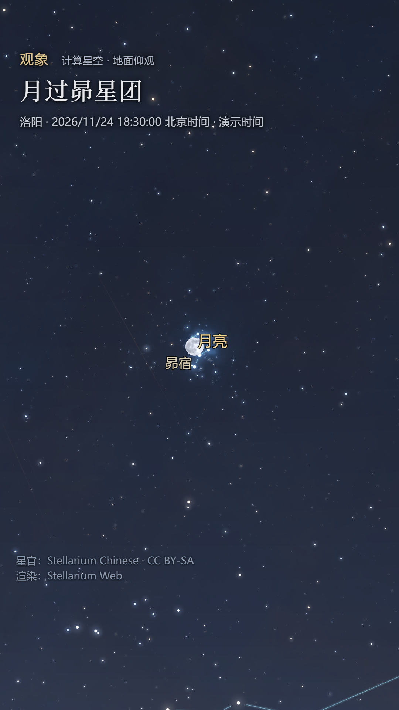

# 观象 · 中文星空直播

中文星官、二十八宿和三垣的直播辅助工具。星空由 Stellarium Web Engine 计算，中文标签跟随同一组观测坐标；控制台和播出页面分开，可以在讲述时切换星宿。

本工具在本机运行，需要 Python 3.10 或更高版本及能访问 Stellarium 官方资源的网络。浏览器建议使用 Edge 或 Chrome。

## 开始使用

1. Windows 双击本目录的 Start-ChineseSky.cmd。也可运行 Start-ChineseSky.ps1。
2. 控制台打开 http://127.0.0.1:8765/ 。点击“打开 OBS 专用画面”可预览纯星图。
3. OBS 添加“浏览器”来源，URL 填 http://127.0.0.1:8765/program 。
4. 横屏设置 1920×1080，竖屏设置 1080×1920，30 fps。关闭“不可见时关闭来源”和“场景激活时刷新”，切换 Scene 时可继续保持星图。

其他系统可在本目录运行 python server.py，再打开控制台地址。服务只监听本机回环地址。

## 主播操作

- 1：紫微垣；2：太微垣；3：天市垣；4：二十八宿；5：北斗；0：全景。
- P：昴宿；M：月亮；T：实时计算。也可直接输入星官中文名定位。
- 星官定位进入全天球讲解；打开“地面观星”可对照当前地点的实际方位。
- 三垣显示左右垣连线和中文总名；二十八宿可分别切换苍龙、玄武、白虎、朱雀七宿。
- 地点和时间可修改，默认演示地点为洛阳。时间输入和播出字幕统一使用北京时间 UTC+8。
- “11月24日·月过昴”预设为洛阳 2026-11-24 18:30，画面明确标示“演示时间”。
- 拖动、滚轮调整控制台预览后，点击“同步预览取景”，独立播出页面会采用这个取景。

## 与实景、YouTube 配合

OBS 建三个 Scene：中文星图、相机或望远镜实景、主播讲述。需要向 YouTube 推流时，以 OBS 统一输出；视频号使用竖屏布景。

使用他人的 YouTube 望远镜直播画面时，先取得转播许可并注明来源。可用独立 Scene 或并排画面，星图的地点和演示时刻按原画面时间戳设置。来源画面存在延迟，直播接收时刻与拍摄时刻需要区分。

望远镜画面的视场、朝向和镜像方式需要另行校准。本工具提供讲解星图；逐像素叠加到望远镜画面需要进一步标定。

- [OBS Browser Source 官方说明](https://obsproject.com/kb/browser-source)
- [使用编码器创建 YouTube 直播](https://support.google.com/youtube/answer/2907883?hl=zh-Hans)
- [YouTube 第三方直播版权说明](https://support.google.com/youtube/answer/3367684?hl=zh-Hans)

## 数据与维护

来源是 Stellarium/stellarium-skycultures 的 chinese：318 个原始星官条目、3209 个星名条目。本次固定源版本为 2d80ce70984c14bba7da2d31a0f9b27e292861c9。

星空文化包负责名称、连线和说明；恒星位置、行星运动和天空渲染由 Stellarium 引擎与星表提供。官网、引擎和文化仓库各自发布，仓库变更与官网部署之间需要核对版本。

上游是不定期维护。直播时采用本地固定数据，不会自动更新星官；实时模式持续计算当前天象。当前固定网页资源为 frontend 1.16.0 / libswe 1.17.0。

维护时保留上游 chinese 目录，运行本目录的 update_data.py 生成 data/index.json 和仓库根目录的 chinese_guanxiang。新增的三个三垣总名是显示注记，锚在代表星附近；垣墙沿用原始连线。二十八宿当前显示星官连线，宿度分界需要另定距星和年代。

显式更新到最新上游数据：

~~~powershell
python update_data.py --latest
git diff --stat
~~~

也可用 --revision 指定完整上游 commit SHA。发布前检查新增名称、连线和预设画面。维护分支名为 fork。

[原始 Chinese 数据及出处](https://github.com/Stellarium/stellarium-skycultures/tree/2d80ce70984c14bba7da2d31a0f9b27e292861c9/chinese)

代码遵循仓库 AGPL-3.0 许可；星官数据沿用原库标示的 CC BY-SA。原作者 Karrie Berglund、Sun Shuwei 和 Stellarium team 的署名保留在数据说明中。
